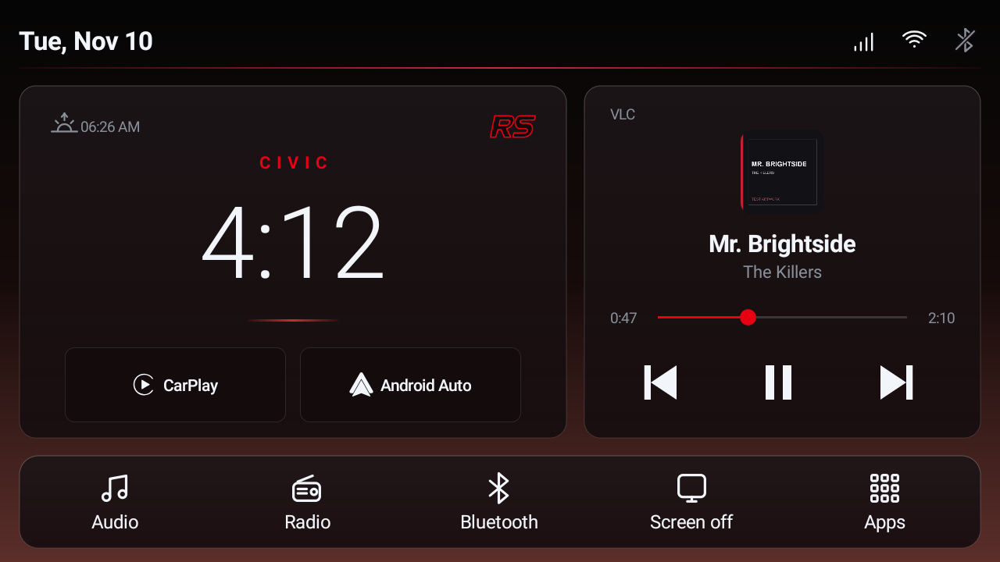
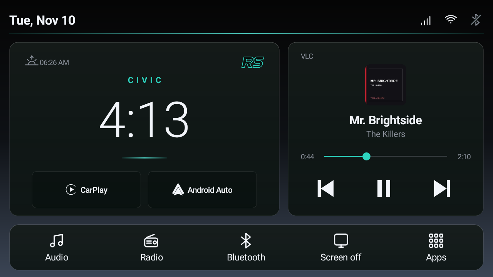

  
  <h1>Flare Auto</h1>
  
<strong>An open-source, offline Android launcher designed for car head units.</strong>

  

    
    
  

Flare Auto runs on the head unit itself. CarPlay and Android Auto require a separate compatible app and hardware.

---

## The dashboard

The home screen brings together a clock, date, sunrise or sunset time, connection indicators and a media card. Choose which cards appear, swap their positions, adjust the split, and configure the bottom dock with your preferred shortcuts.

The media card can show the current track, artist, artwork and playback controls when a compatible app provides them. The app drawer supports hidden apps, icon packs and individual custom icons.

## Screenshots

| Dark red theme | Dark teal theme |
| --- | --- |
|  |  |

Screenshots show a demonstration media track and artwork.

---

## Features

**Home screen**

- Configurable clock, media and app-shortcut cards; adjust card positions and split.
- Media title, artist, artwork, playback controls and seek bar when supported by the source.
- Customizable dock, shortcut order, labels and app assignments.
- Wi-Fi, Bluetooth and supported cellular indicators.

**Make it yours**

- Dark themes, accent color, optional glass-style cards and gradient wallpapers.
- Custom images for Home, the app drawer and screensaver.
- Changeable vehicle label and badge text.
- App drawer with hidden apps, installed icon-pack support and individual icon choices.
- Clock or image screensaver with an optional idle timeout.

**Startup**

- Optionally launch an app or the screensaver after startup.
- Choose a radio or Bluetooth startup source where the head unit supports it, or leave the source to the system.

## Requirements

| | |
| --- | --- |
| Minimum Android | Android 8.0 (API 26) |
| Target Android | Android 9 (API 28) |
| Orientation | Landscape |
| Network | Not required for launcher operation |
| Tested device | Android 9 head unit |

Other devices may behave differently. Vendor-specific shortcuts and startup source selection depend on the head unit and installed apps.

## Installation

1. Download the APK attached to the GitHub release and copy it to a USB drive or another accessible location on the head unit.
2. Open the APK with the head unit’s file manager and follow Android’s installation prompts.
3. Open Flare Auto and select it as the default Home app when prompted, or use the **Default launcher** option in Launcher settings.
4. Configure app shortcuts in Launcher settings. Grant **Media access** to display supported media sessions, and grant location access or enter coordinates for sunrise and sunset.

Keep another launcher installed while checking compatibility. Updates must use the same package ID and signing key as the installed copy. The `app.flare.auto` package installs separately from older `local.civic.home` builds, and settings do not transfer automatically.

## Recommended setup

Flare Auto is designed primarily for low-performance Android head units with limited RAM. On these devices, disabling Android's interface animations can make navigation feel quicker.

### CarPlay and Android Auto

Flare Auto provides shortcuts to projection apps; it does not provide CarPlay or Android Auto itself.

- **Apple CarPlay:** Try [DiPlay](https://github.com/shihabal3amri/DiPlay) on compatible head units.
- **Android Auto:** Try [DiAuto](https://github.com/shihabal3amri/DiAuto) on compatible head units.

Install the appropriate app on the head unit, then assign it to the matching shortcut in **Launcher settings**. Already using ZLink or another compatible projection app? Assign it to the CarPlay or Android Auto button in Launcher settings. The button opens the selected app; connection and compatibility depend on that app and the head unit.

### Performance

To disable Android's interface animations:

1. Open **Android Settings → Developer options**.
2. Set **Window animation scale**, **Transition animation scale**, and **Animator duration scale** to **Animation off**.

This removes visual transitions and can make the interface feel more responsive. It won't necessarily improve playback or app performance.

If you're comfortable with ADB, review preinstalled apps and disable ones you've confirmed are unnecessary. Record your changes so you can reverse them, and test radio, Bluetooth and the backup camera afterward. System packages vary by device, so avoid applying a generic removal list.

## Roadmap

- Add polished launcher animations with a setting to turn them on or off.
- Add more home-screen widgets and customization options.

These are planned ideas, not features available in the current release.

## Permissions and privacy

The launcher requests location for sunrise and sunset, network state for connection indicators, and Bluetooth access for status. Media access is optional and requires the Android notification-listener setting. Solar times use the last known device location or manually entered coordinates; when neither is available, the display shows `--:--`. The device time zone is used.

## Known limitations

- Switching to the head unit’s Bluetooth source during CarPlay playback can cause the media card to lose artwork. Reconnecting DiPlay has restored it on the tested device; this is under investigation.
- Radio, Bluetooth, CarPlay and Android Auto shortcuts launch other apps; availability and behavior depend on the device.
- Initial source selection and startup actions are vendor-dependent.
- Sunset-based dimming is inactive when no solar location is available.

## Build from source

Flare Auto uses Java and Android framework APIs, with no Gradle or AndroidX build setup. The tested build used `javac`, D8, `aapt2`, `jar` and `jarsigner`, with an Android API 28 `android.jar` and Java 8 source compatibility.

Compile the Java sources against the Android API jar, convert the classes to DEX, compile and link `res/` with `AndroidManifest.xml` and `assets/`, add the DEX file and sign the resulting APK with your own key. Exact tool versions and a reproducible build script have not yet been documented.

An APK signed with a different key cannot update an existing installation. Uninstalling the existing app can remove its data. Keep signing keys private.

## Credits and license

Flare Auto includes media-session code adapted from [Dashline](https://github.com/metehankaygsz/dashline), copyright 2026 Metehan Kaygisiz, GPL-3.0-only. See [LICENSE](LICENSE) and [CREDITS.md](CREDITS.md).

Gradient credits are in [GRADIENT-ATTRIBUTION.md](GRADIENT-ATTRIBUTION.md). Simple Icons credits and notices are in [SIMPLE-ICONS-ATTRIBUTION.txt](SIMPLE-ICONS-ATTRIBUTION.txt) and `assets/`. Brand names and marks belong to their respective owners; their inclusion does not imply affiliation or endorsement. Review rights to bundled brand artwork before distribution.
