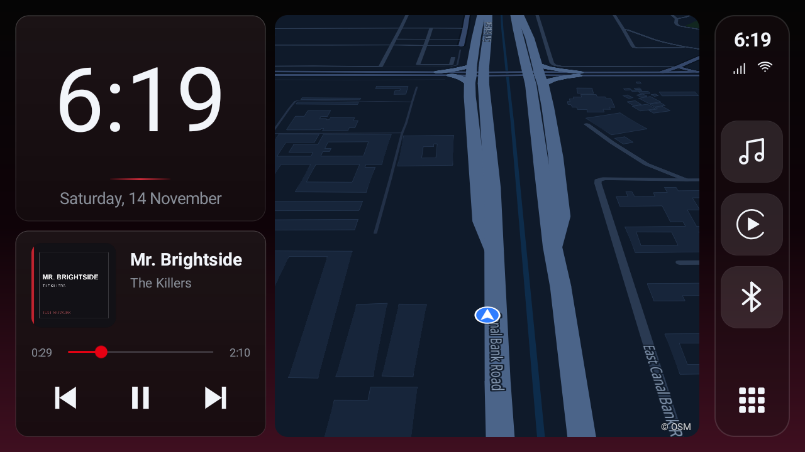
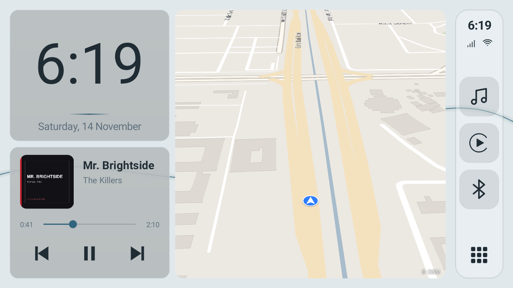
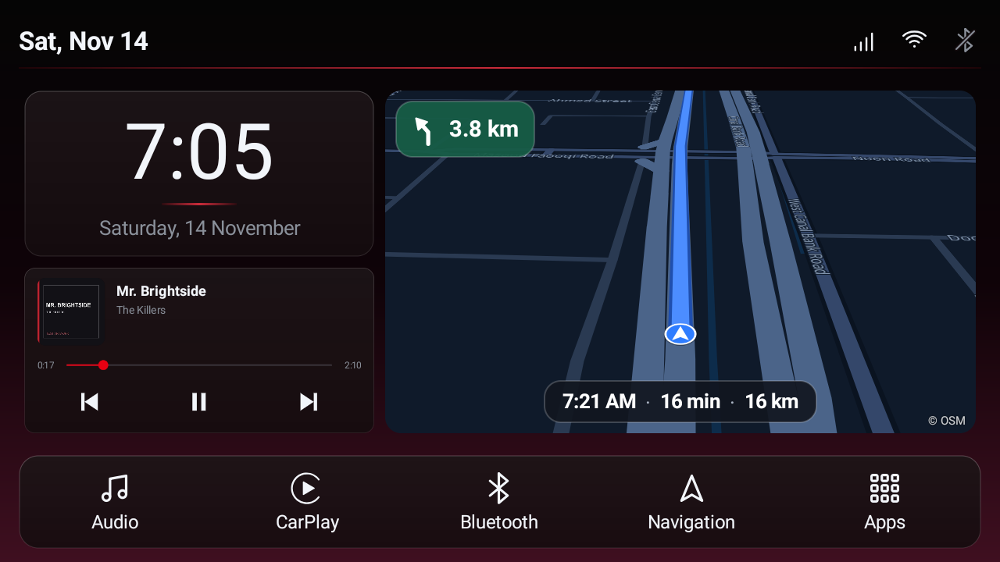
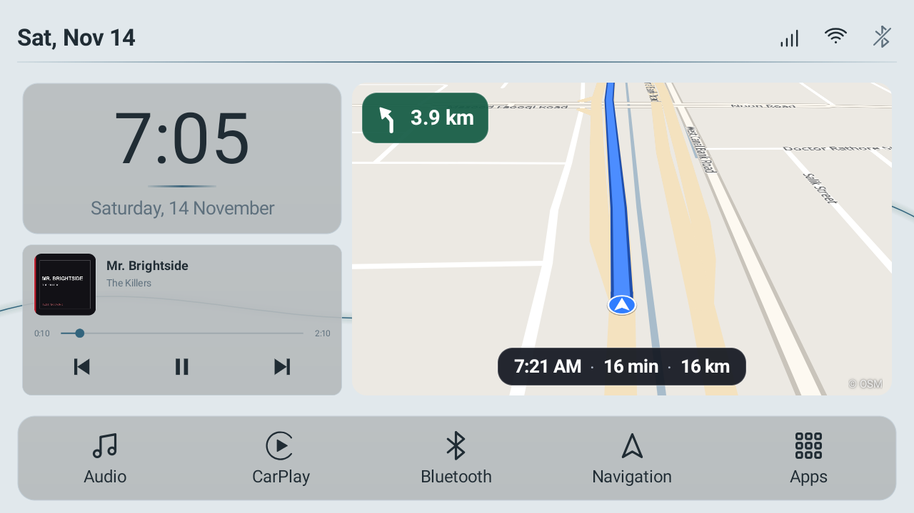
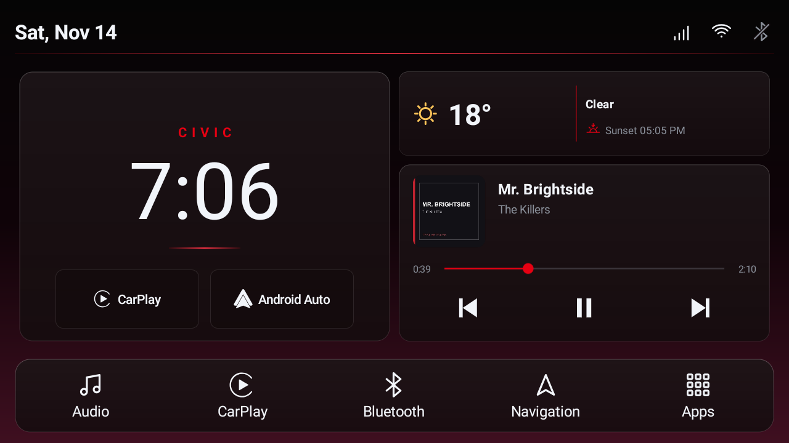
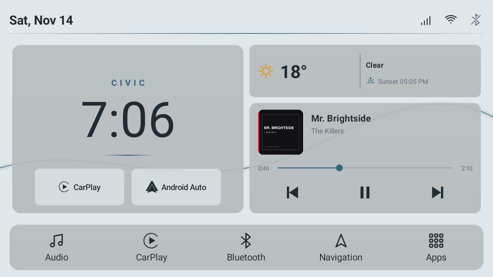

<div align="center">
  
  <h1>Flare Auto</h1>
  <p><strong>An open-source launcher for Android car head units.</strong></p>
  <p>
    <a href="LICENSE"></a>
    <a href="https://github.com/Afshaal/flare-auto/releases/latest"></a>
  </p>
</div>

| | |
| --- | --- |
|  |  |
|  |  |
|  |  |

## Features

- **Home pages** built from widgets on a grid: clocks, media, weather, offline map, CarPlay / Android Auto shortcuts and app shortcuts.
- **Dock** at the bottom, left or right, with your own shortcuts.
- **Offline map** on Home and full screen, in 2D or tilted 3D, with dark and light styles.
- **Offline navigation** with a separate navigation pack: search, route choices, turn-by-turn and spoken directions.
- **Themes** with dark and light modes, accent colours, wallpapers or your own images.
- **Profiles** for different drivers, a screensaver, icon packs and hidden apps.
- **No account, no tracking.** Weather and update checks are optional and off until you use them.

## Install

1. Download the APK from the [latest release](https://github.com/Afshaal/flare-auto/releases/latest).
2. Open it on the head unit and allow the install.
3. Set Flare Auto as the default Home app.

Updates install over the previous version and keep your settings.

Needs Android 8.0 or newer, landscape. CarPlay and Android Auto need their own apps and hardware.

## Map packs

Offline navigation needs a navigation pack:

- [Lahore map pack (r7)](https://github.com/Afshaal/flare-auto/releases/download/v1.2.1/FlareAuto-Lahore-pack-r7.zip)
- [Kuwait map pack (r1)](https://github.com/Afshaal/flare-auto/releases/download/v1.2.1/FlareAuto-Kuwait-pack-r1.zip)

In the app, choose **Settings › Offline maps › Download map pack**. Or copy the ZIP to the head unit and choose
**Settings › Offline maps › Import navigation pack**. Each pack's
`NOTICE.md` lists its data sources.

## Build

```sh
./gradlew assembleRelease testDebugUnitTest lintDebug
```

Signing: copy `keystore.properties.example` to `keystore.properties`. Never commit keys or passwords.

## License

GPL-3.0-only. See [LICENSE](LICENSE). Licence details: [docs/LICENSING.md](docs/LICENSING.md).

## Contributions and credits

Pull requests and issues are welcome.

- **Author:** [Afshaal](https://github.com/Afshaal)
- **Dashline** by Metehan Kaygisiz: media session and playback control code (GPL-3.0-only)
- **720pixel free-gradient-tools:** wallpaper gradients (MIT); see [GRADIENT-ATTRIBUTION.md](GRADIENT-ATTRIBUTION.md)
- **MapLibre Native** 13.0.2: 3D vector map (BSD-2-Clause), with its Apache-2.0 dependencies
- **Mapsforge** 0.25.0: 2D map renderer (LGPL-3.0 with linking exception)
- **AndroidSVG** 1.4 (Apache-2.0)
- **GraphHopper** 1.0: offline routing (Apache-2.0), with HPPC, Commons IO, XML Graphics Commons (Apache-2.0), JTS (EDL-1.0) and SLF4J (MIT)
- **Planetiler:** vector tile builds (Apache-2.0, build tool only)
- **Noto Sans and Noto Sans Arabic:** map labels (SIL Open Font License 1.1)
- **OpenStreetMap** contributors: map, routing and search data (ODbL 1.0)
- **Overture Maps Foundation** contributors: extra places in the Lahore pack search (CDLA-Permissive-2.0)
- **pak-geodata** by Sohaib Bin Mohsin / The Mohsin Project Global: Lahore area names in search (ODbL / CC BY 4.0; unverified)
- **Open-Meteo:** optional weather forecasts (CC BY 4.0)
- **Kotlin** standard library (Apache-2.0)

Full notices: [CREDITS.md](CREDITS.md) and in the app under **Settings › About › Open-source credits**.

Apple CarPlay and Android Auto are trademarks of their owners; they are named only to identify apps. Flare Auto is not affiliated with them.
